# SensePad

SensePad turns a DualSense controller into a drum machine. Buttons play sounds, the sticks run DJ effects, and a looper remembers what you play.

<p align="center">
  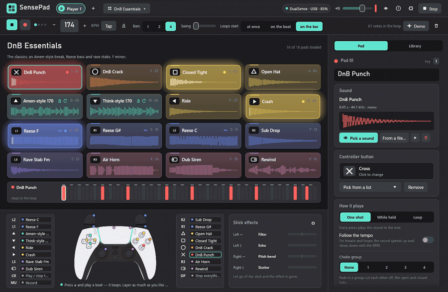
</p>

**Author:** [MarySue](https://github.com/MarySueXLsD) · more of my projects on [itch.io](https://marysue.itch.io)

## Trailer

<p align="center">
  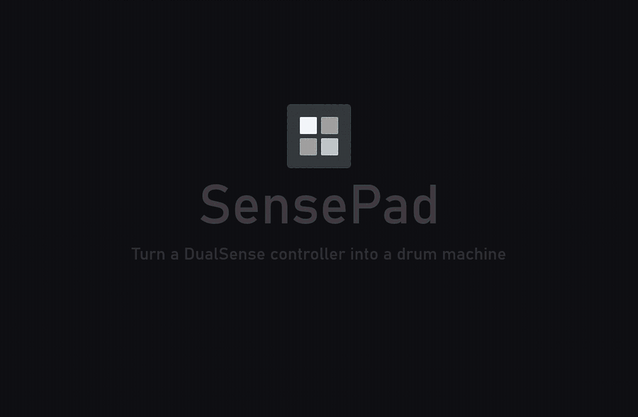
</p>

The same trailer with the app's own sound: **[trailer.mp4](https://github.com/MarySueXLsD/SensePad/raw/main/docs/trailer.mp4)** (24 seconds, 2.6 MB).

## Download

**[Download SensePad for Windows](https://github.com/MarySueXLsD/SensePad/releases/latest)** — the release holds one zip archive.

1. Unpack the archive anywhere. Keep the `packs` folder (recorded drums) next to `sensepad.exe`.
2. Run `sensepad.exe`. There is nothing to install.
3. If Windows shows the blue "Windows protected your PC" window, choose "More info" → "Run anyway". It appears because the program has no paid code signature.

You need Windows 10 or 11 (64-bit). The controller connects over USB-C or Bluetooth; without one you can play from the keyboard.

The interface comes in English and Russian. It starts in English, or in Russian when Windows itself is in Russian, and you can switch in the welcome tour or in Settings → General.

## What it does

- **16 pads.** Each pad is a sound and a controller button. A pad shows its button, name and waveform, and flashes when hit.
- **A looper that records.** Tempo, start and stop, recording snapped to the grid, 1–4 bars, swing, metronome, tap tempo. Click the steps of the selected pad to edit them.
- **Effects on the sticks.** Filter, echo, pitch, stutter, bitcrush, volume cut, pan. Echo and stutter follow the tempo. The touchpad can become an XY pad.
- **10 ready kits with demo beats:** drum and bass, jungle, neurofunk, liquid, phonk, hardbass, 808 trap, house, live breaks, percussion.
- **About 140 synthesised sounds** by category: kicks, snares, claps, hi-hats, cymbals, percussion, breaks, loops, bass, stabs, keys, effects, vocals. Breaks and loops follow the tempo.
- **Recorded drum packs:** 146 more sounds — a rock kit, a jazz kit, 23 snares, hand claps, congas, bongos, djembe, darbouka, and break loops played with those drums.
- **The real DualSense** over USB and Bluetooth: the light bar takes your profile colour, pads flash it in their own colour, plus rumble, a record light on the mute button and the battery level.
- **Profiles.** Each profile has its own name, kit, colour and controller lights, so several people can share one computer.
- **A welcome tour and a built-in guide.** The tour runs on first start; the guide opens with F1.

## Screenshots

| | |
| --- | --- |
| 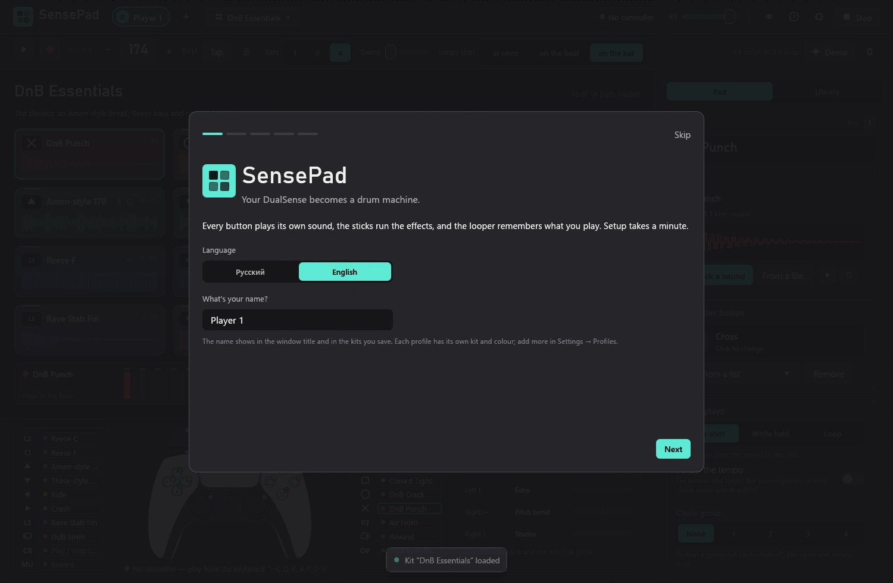 | 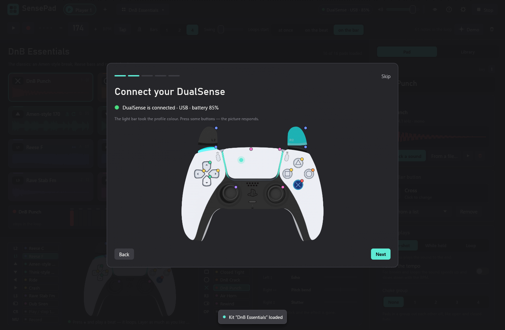 |
| First start: pick a language and type your name | The controller on screen mirrors what you press |
| 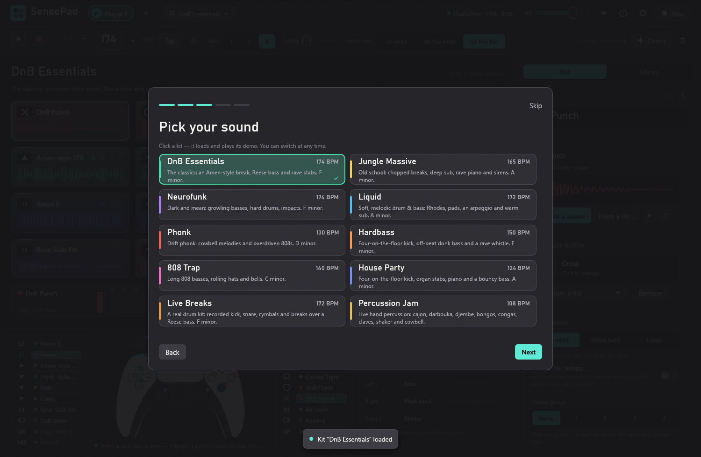 | 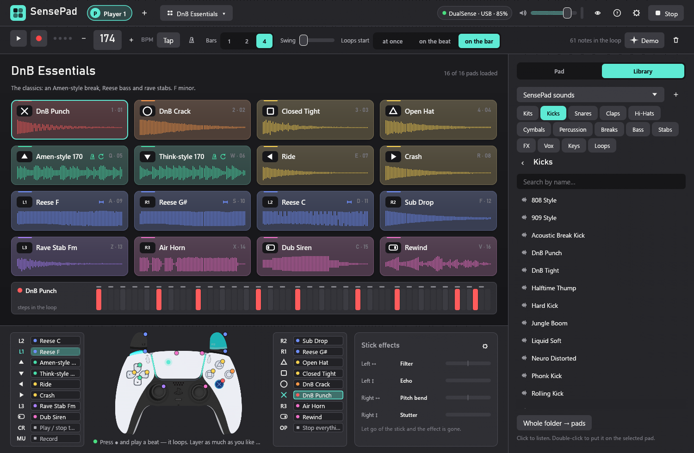 |
| Ten kits, each with its own demo beat | The sound library, sorted by category |
| 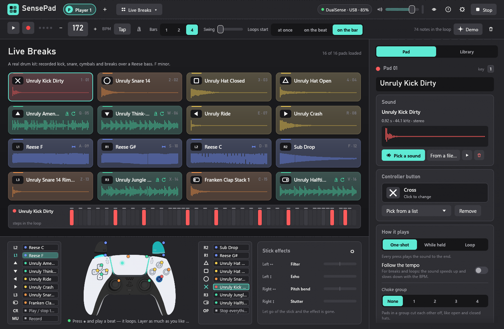 | 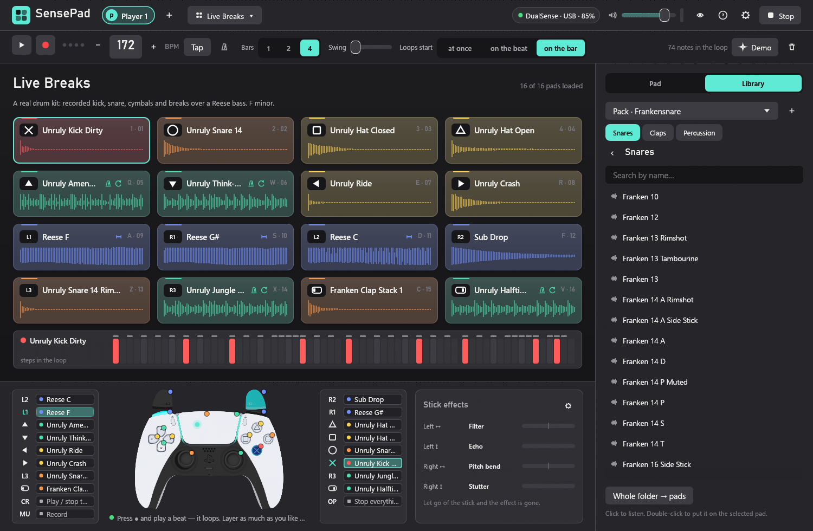 |
| The Live Breaks kit, built on recorded drums | A pack of recorded snares in the library |
| 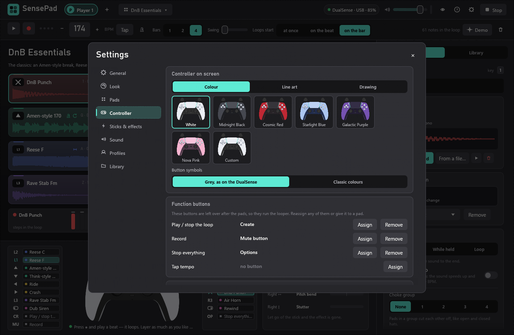 | 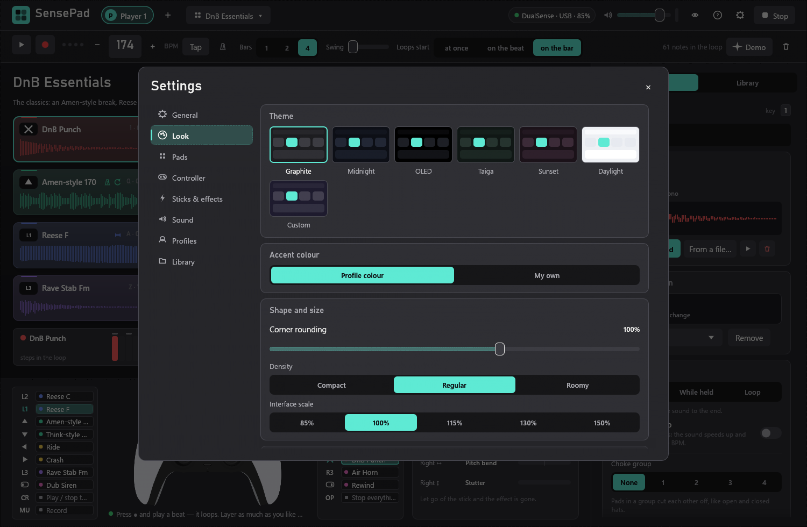 |
| Controller colourways and function buttons | Themes, accent colour, density, scale |
| 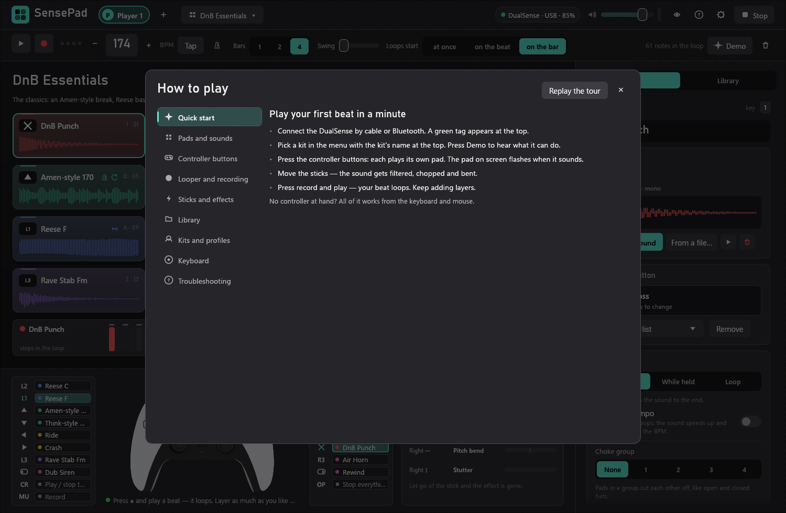 | 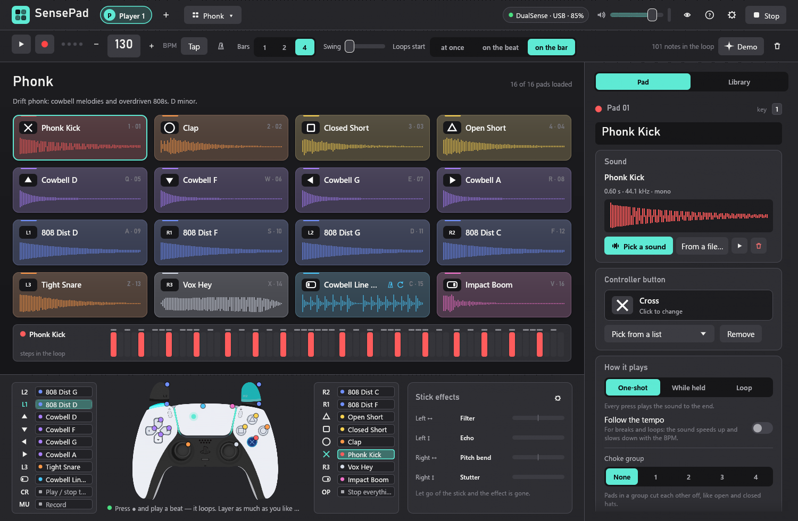 |
| The guide inside the app (F1) | The Phonk kit |
| 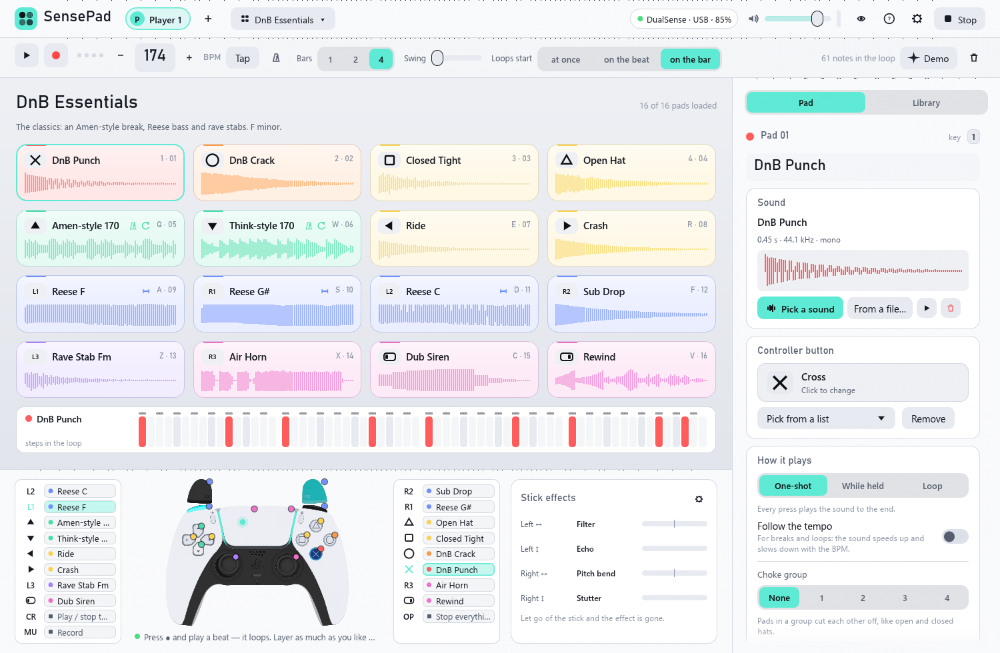 | 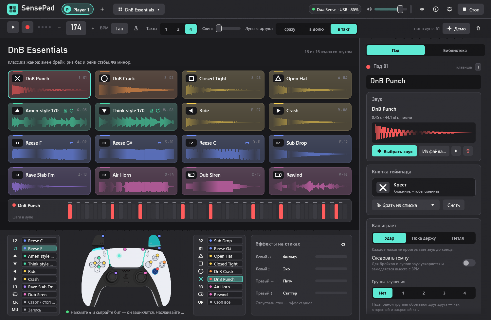 |
| The light theme | The same screen in Russian |

## Getting started

1. Run `sensepad.exe`.
2. Follow the welcome tour: type your name, connect the controller, pick a kit.
3. Press the buttons. Press record and play a beat — it loops.

Without a controller everything works from the keyboard: `1-4`, `Q-R`, `A-F` and `Z-V` play the pads, `Space` starts the loop, `Enter` turns recording on, `Backspace` stops everything.

## Default controller buttons

| Buttons | What they do |
| --- | --- |
| Cross, circle, square, triangle, the D-pad, L1/R1, L2/R2, L3/R3, the two halves of the touchpad | The 16 pads |
| Create | Start and stop the loop |
| Mute button | Record |
| Options | Stop everything |

Any button can be reassigned: click it on the controller picture or in the pad's card. The function buttons are changed in Settings → Controller.

## What you can change

- **Appearance:** seven themes (one of them built from a background colour you choose), accent colour, corner rounding, density, scale, glow and animations.
- **Pads:** a 4 × 4 grid or two rows of 8, what a pad shows, which panels are visible.
- **Controller:** a colour, line-art or drawn picture, seven colourways plus your own colours, light bar mode and brightness, rumble strength, trigger travel.
- **Sticks:** an effect for each direction, "spring" or "knob" behaviour, dead zone, pitch range.
- **Sound:** output device, latency, volume, metronome.
- **Layout:** drag the edge of the sidebar and of the controller bar to resize them.

## Your own sounds

Drop an audio file on a pad, or add a folder of your own in the library (the plus next to the list of sources). WAV, MP3, FLAC, OGG, AIFF and M4A all work. If FL Studio is installed, its packs show up in the library by themselves.

SensePad's own sounds are synthesised on your computer on first start. The famous breaks are recreated from their patterns; they are not the original recordings.

## Recorded drum packs

The archive includes a `packs` folder with four packs of recorded drums and percussion. In the library each one is a separate source ("Pack · …"), and the kits Live Breaks and Percussion Jam are built from them.

| Pack | What is inside | Recorded by |
| --- | --- | --- |
| Unruly Drums | 32 sounds and 5 breaks: a loud, dirty rock kit | Karoryfer Samples |
| Swirly Drums | 30 sounds and 4 breaks: a dry kit, toms, darbouka, djembe, bongos, cowbell | Karoryfer Samples |
| Frankensnare | 30 sounds: 23 snares of different sizes, hand claps, tambourine | Karoryfer Samples |
| Virtuosity Drums | 41 sounds and 4 breaks: a jazz kit, congas, claves, shaker, agogo, triangle | Versilian Studios |

All the recordings are in the public domain (CC0 1.0). The source libraries were recorded with several microphones; for SensePad the microphones of each hit were mixed into one file, trimmed and levelled. The breaks are the built-in library's patterns played with the recorded drums.

To make your own pack, put a folder inside `packs` with subfolders named `Kicks`, `Snares`, `Claps`, `Hi-Hats`, `Cymbals`, `Percussion` and `Breaks`. If a file in `Breaks` has a tempo in its name ("My Break 170"), the loop follows the project tempo.

## If something goes wrong

- **The controller is not found.** Close Steam, DS4Windows and DualSenseX: they take the controller for themselves.
- **No sound.** Settings → Sound: pick the output device and press "Reconnect the sound".
- **The sound is late or crackles.** Settings → Sound → Latency.
- **Settings are not saved.** The app shows a message and writes the reason to `sensepad.log` in the data folder.

Settings, profiles, kits and sounds live in `%APPDATA%\SensePad`. Set the `SENSEPAD_DATA` environment variable to use another folder.

## Building from source

You need Rust (`x86_64-pc-windows-gnu`) and MinGW-w64.

```bash
winget install BrechtSanders.WinLibs.POSIX.UCRT
```

```bash
cargo build --release
```

The program appears at `target\release\sensepad.exe`.

Run the tests:

```bash
cargo test --release
```

Render every screen to a picture without opening a window (saved to `target/preview`):

```bash
cargo test --release preview -- --ignored
```

The preview GIF and the trailer at the top of this page are recorded the same way: a script plays the app without a window, with the sound engine running in step with the pictures. Record the frames, then encode them (needs Python with the `imageio-ffmpeg` package):

```bash
cargo test --release render_trailer -- --ignored
```

```bash
python tools/trailer/build.py
```

The packs are not kept in git: they ship in the release archive and are built from the source recordings. The recipe is `tools/packs/manifest.json` (written by `tools/packs/plan.py`). Download the recordings (about 54 MB) and build the `packs` folder:

```bash
python tools/packs/fetch.py tools/packs/manifest.json target/pack-src
```

```bash
SENSEPAD_PACK_SRC=target/pack-src cargo test --release build_packs -- --ignored
```

## How the code is laid out

| File | What is in it |
| --- | --- |
| `src/audio.rs` | The sound engine: sampler, clock and looper, effects |
| `src/seq.rs` | The loop pattern |
| `src/dualsense.rs` | The DualSense driver (HID): buttons, sticks, touchpad, lights, rumble |
| `src/factory.rs` | Sound synthesis and the ready kits with their demo beats |
| `src/kit.rs` | Profiles, kits, settings and saving them |
| `src/app.rs` | Application state and logic |
| `src/ui/` | Screens: bars, pads, library, settings, welcome tour, guide |
| `src/controller_skin.rs`, `src/controller_art.rs`, `src/controller_view.rs` | The three controller pictures: colour, line art, drawn |
| `src/theme.rs`, `src/icons.rs` | Themes, fonts, icons |
| `src/i18n.rs` | English and Russian interface text |
| `src/library.rs` | The sound library: built-in sounds, packs, your folders |
| `src/packtool.rs`, `tools/packs/` | Building the packs: mixing microphones, trimming, breaks |
| `src/preview.rs` | Rendering the interface to PNG files for checking |
| `src/trailer.rs`, `tools/trailer/` | Recording the preview GIF and the trailer |

## Credits

- The drum packs are built from [Unruly Drums](https://github.com/sfzinstruments/karoryfer.unruly-drums), [Swirly Drums](https://github.com/sfzinstruments/karoryfer.swirly-drums) and [Frankensnare](https://github.com/sfzinstruments/karoryfer.frankensnare) by **Karoryfer Samples** and [Virtuosity Drums](https://github.com/sfzinstruments/virtuosity_drums) by **Versilian Studios**. Their authors released them into the public domain (CC0 1.0) — thank you.
- The colour controller (`assets/gv/`) is the PS5 skin for GamepadViewer by **CrazyGrape**. It was taken from [8bitdev0x8/ps5-controller-visualizer](https://github.com/8bitdev0x8/ps5-controller-visualizer) and split into layers with `tools/split_gv_skin.py` so the colourway can be changed. The pictures belong to their author and have no open licence. If you are the author and want them removed, open an issue.
- The line-art controller (`assets/dualsense.png`) is by an unknown author. If it is yours, open an issue and it will be credited or removed.
- DualSense and PlayStation are trademarks of Sony Interactive Entertainment. SensePad is a fan project and is not affiliated with Sony.
